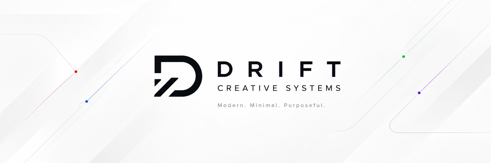

# Drift: Dashboard

A desktop app for Windows and macOS from [Drift Creative Systems](https://driftcreativesystems.co.uk/) that shows everything at a glance, so you don't have to open Shift and click through accounts. The app itself is called **Drift Dashboard** (it was Bonsai Dashboard up to 1.10.0).

| Section | What it shows |
|---|---|
| **Up next** | Next events across all your Google, Outlook and Proton calendars, merged |
| **Spotify** | What's playing now (or the last track) |
| **Plex** | Who's streaming from your Plex server right now and what they're watching |
| **Claude plan usage** | How much of your Pro/Max session and weekly limits you've used, and when they reset |
| **Strava** | This week's run time, walk time and gym sessions (from Monday) |
| **Xbox** | Last game played |
| **Drift: Record** | The next gig or festival you're going to (countdown, venue, doors, train, hotel), the few after it, and this year's count and spend |
| **Email** | One card per inbox (Gmail, Outlook, Proton): unread count + latest 3 emails |
| **Slack** | One card per workspace: latest direct messages |
| **ClickUp** | Due this week (incl. overdue) + recent activity on your tasks |
| **Weather** | Now, today, the next 8 hours and tomorrow for your location |
| **Money** | FreeAgent: bank balances, overdue and soon-due invoices, bills due this week, upcoming tax deadlines |
| **Support & uptime** | Support Desk tickets per site (open counts, mine, unassigned, SLA missed, latest) + Bonsai Uptime Monitor (sites down, SSL/domain expiring, recent incidents) |
| **GitHub** | One card per account: latest repo activity + failed Actions runs |

Click any email, message, task, event or ticket to open it in your browser, or in an app you choose (see [Opening links in a particular app](#opening-links-in-a-particular-app)). Slack opens in the Slack app.

It's a normal window (not always on top). Closing it keeps it in the system tray; right-click the tray icon to quit. While the window is hidden or minimised it stops checking, then catches up when you open it.

---

## Part 1: Install and run it (once)

### 1. Check Node.js is installed

Open **PowerShell** (Start → type "PowerShell") and run:

```powershell
node -v
```

You should see `v20` or higher. If it says "not recognised", install the LTS version from [nodejs.org](https://nodejs.org/), then close and reopen PowerShell.

### 2. Install the app's packages

```powershell
cd "D:\Gak Design\Web\Drift\Drift Dashboard"
npm install
```

### 3. Preview it with sample data

```powershell
npm run demo
```

The first run downloads Electron (about 100 MB), so give it a minute. You'll see the dashboard filled with made-up data. This uses a separate settings folder, so nothing you do here is kept. Close the window when you're done (demo mode quits instead of going to the tray).

### 4. Run it for real

```powershell
npm start
```

You'll see "Nothing to show yet". Click **Settings** and add your accounts using Part 2.

### 5. Build an installer (optional, recommended once it's set up)

```powershell
npm run dist
```

This creates `dist\Drift Dashboard Setup <version>.exe` (e.g. `1.1.0`). Released installers are also on the public [releases page](https://github.com/drift-creative-systems/bonsai-dashboard-releases/releases/latest), so anyone (e.g. the Realityhouse team) can download one there instead of building it. Run it to install the app like any other program, with a Start menu entry and a desktop shortcut. Then you can tick **Start with Windows** in Settings.

> Windows SmartScreen will warn you that the installer isn't signed. Click **More info → Run anyway**. Signing needs a paid code-signing certificate, which isn't worth it for an internal tool.

Your accounts are stored per Windows user (see [Where your data lives](#where-your-data-lives)), so the installed app and `npm start` share the same accounts.

### 6. On a Mac: build it as an app

Steps 1–4 work on a Mac too, using **Terminal** instead of PowerShell (and your own folder path, e.g. `cd ~/Code/drift-dashboard`). To use it like any other Mac app, with an icon in Applications and the Dock, build it once:

```
npm run mac
```

This builds `Drift Dashboard.app` for your Mac's chip, signs it for this Mac only, and copies it to **Applications**, replacing any older copy. Quit the dashboard first (menu bar icon → **Quit**). The script stops if it's still running. Then open it from Applications or Spotlight.

- **Your accounts carry over.** They're kept in `~/Library/Application Support/Drift Dashboard`, not in the app, and `npm start` uses the same folder.
- **Keychain prompt:** the first time (and after each rebuild), macOS may ask to let Drift Dashboard use **"Drift Dashboard Safe Storage"**. That's the key your saved passwords are encrypted with. Enter your Mac password and click **Always Allow**. If you click Deny, cards that need a password or token will say they aren't set up.
- **Open at login:** tick it in Settings → General. The app then starts in the menu bar without opening the window.
- **Updating:** the Mac app doesn't update itself, because macOS only allows that for apps signed with a paid Apple Developer ID. Pull the latest code and run `npm run mac` again.
- This build is for your own Mac. Sending it to someone else would need Apple Developer ID signing and notarisation, or they'd have to get past Gatekeeper's warnings.
- `npm run mac -- --no-install` builds it into `dist/` without installing it.

### Updates

From version 1.1.0 the installed Windows app updates itself (the Mac app doesn't; see step 6). It checks when it opens and every 6 hours, downloads new versions in the background, then shows **"Drift Dashboard 1.x.x is ready" → Restart to update**. Choose **Later** and it installs the next time you quit. **Settings → Updates → Check for updates** checks straight away.

> Version 1.0.0 has no updater: install 1.1.0 by hand once from the [releases page](https://github.com/drift-creative-systems/bonsai-dashboard-releases/releases/latest). Your accounts and layout are kept.

---

## Part 2: Connect each service

Everything is added in **Settings → Add an account**: pick the **Type**, give it a **Card name** (e.g. "Gak Design" or "Bonsai"), fill the fields, then **Save**. Each one turns into a card.

The steps below are also in the app: open **How to set this up** under the Type when you add or edit an account. The app reads them from this README, so there's only one copy to keep up to date.

Sign-in services (Outlook, Google Calendar with colours, Spotify, Strava) open your browser to log in as soon as you save. Approve it, close the tab, and the card fills in.

Suggested order: start with the quick ones (Weather, ClickUp, calendars, Xbox, Plex), then email, Slack, Outlook, GitHub, FreeAgent, Spotify and Strava. Support tickets and the uptime monitor need their server updates deployed first.

**Card icons:** each card shows the service's logo (Gmail, Proton, Google Calendar, ClickUp, GitHub, Spotify, Plex, Strava), the Bonsai mark for support tickets and uptime, or a coloured letter for services with no free logo (Outlook, Slack, Xbox, FreeAgent). To tell several cards of the same type apart, go to **Settings → Edit → Icon** and type an emoji or up to 2 letters, and/or pick a colour. **Use default** puts the colour back. The colour is also used for the card's border and, for calendars, their dots in Up next.

### Gmail inboxes (×7)

Gmail uses an **app password**: a 16-letter password just for this app, which you can revoke at any time.

For **each** Gmail account:

1. Sign in to that account and open [myaccount.google.com/security](https://myaccount.google.com/security).
2. Make sure **2-Step Verification** is on (app passwords need it).
3. Open [myaccount.google.com/apppasswords](https://myaccount.google.com/apppasswords), type the name `Drift Dashboard` and click **Create**.
4. Copy the 16-letter password (spaces don't matter).
5. In the dashboard: **Type: Gmail**, enter the email address and paste the app password. **Save**.

**Which emails the card lists** (the **Show** option):

- **Unread emails** (the default): the latest 3 unread, and the unread count.
- **Important and unread emails**: only unread emails Gmail has marked **Important** (the yellow marker). The count is of those too. It uses Gmail's own search, so it matches `is:important is:unread` in Gmail.
- **Latest emails, read or not**: the latest 3 in the inbox.

**Google Workspace accounts** (your own domains): if the app passwords page says "not available", the Workspace admin has to allow it. Go to [admin.google.com](https://admin.google.com) → Security → Authentication → 2-Step Verification → allow users to turn it on. Also check Apps → Google Workspace → Gmail → End User Access → **IMAP access** is on.

### Google calendars (×7)

Calendars use each calendar's **secret iCal address**, so no sign-in is needed.

For each account:

1. Open [calendar.google.com](https://calendar.google.com) signed in as that account.
2. Click the cog → **Settings** → on the left under "Settings for my calendars", click your calendar.
3. Scroll to **Integrate calendar** → copy **Secret address in iCal format**.
4. In the dashboard: **Type: Calendar (iCal link)**, Card name e.g. "Gak Design", paste the address. **Save**.

Events from every calendar are merged into the **Up next** card, colour-coded by calendar. Google updates these links every few hours at most, so a brand-new event can take a while to appear.

Google's iCal links don't include the colours you give events. To see those, use [Google Calendar with event colours](#google-calendar-with-event-colours-optional-instead-of-the-ical-link) instead.

> **Workspace:** if "Secret address" is missing, the admin has to allow it under Apps → Google Workspace → Calendar → Sharing settings → External sharing options → "Share all information".

> Anyone with that link can see your calendar, which is why the dashboard stores it encrypted. If it ever leaks, click **Reset** next to it in Google Calendar.

### Google Calendar with event colours (optional, instead of the iCal link)

This card signs in to Google Calendar, so Up next shows each event in the colour you gave it in Google Calendar (Tomato, Banana, Peacock and so on). Events without their own colour use the calendar's colour. New events also appear within 5 minutes instead of hours. It needs a free Google Cloud "OAuth client", made once (about 10 minutes), which then works for all your Google accounts.

**Once: create the OAuth client**

1. Go to [console.cloud.google.com](https://console.cloud.google.com), sign in with any of your Google accounts, and create a project called `Drift Dashboard`.
2. Open [the Google Calendar API page](https://console.cloud.google.com/apis/library/calendar-json.googleapis.com) and click **Enable**.
3. Open **Google Auth Platform** (APIs & Services → OAuth consent screen) → **Get started**:
   - App name: `Drift Dashboard`, support email: yours.
   - Audience: **External** (so it works for every account, not only that one's Workspace).
   - Contact email: yours. Agree and **Create**.
4. **Audience** → **Publish app** → Confirm. This matters: while the app is in **Testing**, Google signs it out every 7 days. You don't need Google to verify it; it's only for you.
5. **Clients** → **Create client** → Application type **Desktop app**, name `Drift Dashboard` → **Create**. Copy the **Client ID** and **Client secret** straight away (Google may only show the secret once).

**For each Google account:**

1. In the dashboard: **Type: Google Calendar (sign-in, with colours)**, Card name e.g. "Gak Design", paste the client ID and secret. **Save**.
2. Your browser opens. Choose the account. Google warns **"Google hasn't verified this app"**: click **Advanced → Go to Drift Dashboard (unsafe)**. It's your own app, asking only to *view* your calendars. Then **Continue**.

To show other calendars you've ticked in Google Calendar as well (shared or team calendars), tick **Also include the other calendars ticked in Google Calendar**. Their name appears after the card name in Up next.

Remove the iCal card for an account once its sign-in card works, or its events show twice.

Colours: an event's own colour comes first, then the card's **Icon colour** if you've set one, then the calendar's colour in Google.

> **Workspace accounts:** if sign-in says the app is blocked, the admin has to trust it: [admin.google.com](https://admin.google.com) → Security → Access and data control → API controls → Manage third-party app access → add the client ID and set it to **Trusted** (or allow unconfigured apps).

> The client secret isn't really secret for desktop apps (Google says so), but it's stored encrypted like everything else.

### Outlook (×1), email and calendar

Outlook needs a free **app registration** with Microsoft (about 10 minutes, once).

1. Go to [entra.microsoft.com](https://entra.microsoft.com) and sign in with your Microsoft account.
   - If it says you don't have access or a directory, sign up for a free [Azure account](https://azure.microsoft.com/free/). That creates the directory (no charges for this).
2. **Applications → App registrations → New registration**.
   - Name: `Drift Dashboard`
   - Supported account types: **Accounts in any organizational directory and personal Microsoft accounts**
   - Redirect URI: choose **Public client/native (mobile & desktop)** and enter exactly `http://localhost:8890/callback`
   - Click **Register**.
3. On the overview page, copy the **Application (client) ID**.
4. **API permissions → Add a permission → Microsoft Graph → Delegated permissions**, tick `Mail.Read`, `Calendars.Read` and `offline_access`, then **Add permissions**. (`User.Read` is already there.)
5. In the dashboard: **Type: Outlook**, paste the client ID, leave **Show this calendar in Up next** ticked. **Save**. Your browser opens; sign in to the Outlook account and **Accept**.

The same client ID works for more Outlook accounts later; just add another Outlook card and sign in with the other account.

### Proton Mail (×1)

Proton has no API. The only way in is **Proton Mail Bridge**, which needs a **paid Proton plan**.

1. Install [Proton Mail Bridge](https://proton.me/mail/bridge) and sign in.
2. In Bridge, click your account → **Mailbox details** (or "Configure email client"). Note the **IMAP username** and **password** (this password is different from your Proton password), plus the port (normally `1143`).
3. In the dashboard: **Type: Proton Mail**, enter the Bridge username as the email address and paste the Bridge password. If Bridge shows a port other than 1143, open **Advanced** and set it. **Save**.

Bridge must be running for the card to update. Set it to start with Windows in Bridge's settings. If it isn't running, the card says so and retries.

**Proton Calendar** (optional): Proton Calendar → Settings → Calendars → your calendar → **Share** → **Create link** ("Share with anyone", full view). Add that link as a **Calendar (iCal link)** card.

### Slack (×3 workspaces)

Each workspace needs its own small private Slack app (5 minutes each). It only has read access to your DMs and the channels you choose.

For **each** workspace:

1. Go to [api.slack.com/apps](https://api.slack.com/apps) → **Create New App** → **From a manifest**.
2. Pick the workspace and click **Next**.
3. Choose the **JSON** tab, replace everything with the manifest below, then **Next** → **Create**:

   ```json
   {
     "display_information": {
       "name": "Drift Dashboard",
       "description": "Read-only feed of my latest DMs for my desktop dashboard"
     },
     "oauth_config": {
       "scopes": {
         "user": [
           "im:history",
           "im:read",
           "mpim:history",
           "mpim:read",
           "channels:history",
           "channels:read",
           "groups:history",
           "groups:read",
           "users:read"
         ]
       }
     },
     "settings": {
       "org_deploy_enabled": false,
       "socket_mode_enabled": false,
       "token_rotation_enabled": false
     }
   }
   ```

4. Click **Install to Workspace** → **Allow**. On a workspace where you're not an admin (e.g. a client's), this sends an approval request to their admin instead.
5. Go to **OAuth & Permissions** and copy the **User OAuth Token** (starts `xoxp-`).
6. In the dashboard: **Type: Slack**, Card name e.g. "Realityhouse", paste the token. **Save**.

The card shows your latest direct and group messages. To also watch specific channels, open **Advanced** and add their channel IDs: in Slack, right-click the channel → **View channel details** → the ID is at the bottom (e.g. `C0123ABCD`).

### ClickUp (×2)

1. In ClickUp: click your avatar (bottom left) → **Settings** → **Apps** → **API Token** → **Generate** (or **Copy**). It starts `pk_`.
2. In the dashboard: **Type: ClickUp**, paste the token. **Save**.

**Two ClickUps:**
- **Two separate logins:** add one ClickUp card per login, each with its own token.
- **One login in two workspaces:** one token sees both, and a single card shows them together. If you'd rather have a card per workspace, add two cards with the same token and put each workspace's ID in **Advanced → Only these workspace IDs**. The ID is the number in the ClickUp URL: `app.clickup.com/`**`1234567`**`/…`

The card shows **Due this week** (including overdue) and **Recent activity on your tasks**: tasks assigned to you that changed in the last 3 days, most recent first. ClickUp's own Inbox can't be read by apps, so this is the closest equivalent.

### Spotify

1. Go to [developer.spotify.com/dashboard](https://developer.spotify.com/dashboard), log in and accept the terms.
2. **Create app**:
   - App name: `Drift Dashboard`, description: `Personal desktop dashboard`
   - Redirect URI: exactly `http://127.0.0.1:8890/callback` → **Add**
   - Tick **Web API**, accept the terms → **Save**
3. Open the app → **Settings** → copy the **Client ID**.
4. In the dashboard: **Type: Spotify**, paste the Client ID. **Save**. Your browser opens; click **Agree**.

### Plex

No sign-in or developer app needed. The card talks straight to your own Plex Media Server, so this PC needs to be on the same network as the server.

1. **Find the server address.** In Plex Web go to **Settings → (your server) → Remote Access**: the private IP is shown there, e.g. `192.168.1.20`. The port is `32400` unless you've changed it.
2. **Get your Plex token.** In Plex Web, open any film or episode → **⋯ → Get Info → View XML**. A new tab opens; the address ends in `X-Plex-Token=…`. Copy that value (or the whole address: the dashboard pulls the token out for you).
3. In the dashboard: **Type: Plex**, Server address `http://192.168.1.20:32400` (or just `192.168.1.20`), paste the token. **Save**.

The card checks every 30 seconds and shows one row per stream: who's watching, the show (with season and episode) or film, which device, playing or paused, time left with a progress bar, and whether it's a direct play or a transcode, plus the resolution and **Remote** for streams from outside your network. The heading shows the number of streams, how many are transcoding and the total bandwidth. Click a stream or **Open Plex** to open Plex Web.

Plain `http://` is only accepted for local addresses (192.168.x.x, 10.x.x.x, 172.16–31.x.x, localhost, `.local`); anything else must be `https://`. Posters are fetched by the app and passed to the card as images, so the token never leaves the main process.

The token is your Plex account's sign-in token, so treat it like a password. It's stored encrypted like the other keys. If you sign out of all devices in Plex, the token changes and the card asks for a new one.

### Claude plan usage

Nothing to set up beyond Claude Code itself. The card shows the same figures as Claude Code's `/usage`: how much of your Pro or Max plan's limits you've used.

1. Make sure you're signed in to Claude Code on this computer with your Claude account: open Terminal (Mac) or PowerShell (Windows), run `claude`, then `/login` if it asks. Signing in to the Claude desktop app isn't enough; it has to be Claude Code.
2. In the dashboard: **Type: Claude plan usage**. Leave **Claude settings folder** blank unless you've moved it (or set `CLAUDE_CONFIG_DIR`, which the card also respects). **Save**.
3. **Mac only:** the first time, macOS may ask whether to let the dashboard use "Claude Code-credentials" from your keychain. Enter your Mac password and click **Always Allow**. (Usually it doesn't ask, because the dashboard reads it the same way Claude Code does.)

The card checks every 5 minutes and shows:

- **Current session**: % of the 5-hour limit used, with the reset time and how long until then.
- **Weekly · all models**: % of the weekly limit used and when it resets. Any other limits Claude reports (e.g. a separate Opus weekly limit) appear the same way.
- Bars turn amber from 75% and red from 90% (or when Claude flags the limit).
- **Extra usage**: credits used once you've hit a limit, if you've switched that on.
- **This week by app**: how this week's usage splits between Claude Code, chats, Cowork and so on.
- **Clawd**: the pixel crab from Claude Code's welcome screen, in a strip across the top of the card. His mood follows the current session: he wanders and follows your mouse, dozes if the card's been ignored for 10 minutes, sweats from 90%, lies belly-up at 100%, burrows into the sand while the card has an error, and celebrates when the session resets. Click him for a random Claude Code animation. With reduced motion on (Mac: System Settings → Accessibility → Display → Reduce motion; Windows: Settings → Accessibility → Visual effects → Animation effects off), he only moves when clicked. Ported from [clawd-usage-winwidget](https://github.com/Enhed/clawd-usage-winwidget) by Venger Sergey (MIT licence). Clawd and Claude are Anthropic's.

How it works: the card reads the sign-in Claude Code saves and asks Claude's usage service, the same one `/usage` uses. Where that sign-in lives depends on the computer:

- **Mac:** in your login keychain, as an item called `Claude Code-credentials` (you can see it in the Keychain Access app). If you've set `CLAUDE_CONFIG_DIR`, Claude Code adds a short code to the name (e.g. `Claude Code-credentials-1a2b3c4d`), and the card works that out from the folder. If it can't find a current sign-in under the expected names, it looks through any other `Claude Code-credentials-…` items and uses the newest. It reads them with Apple's `security` tool, the same way Claude Code does.
- **Windows:** `%USERPROFILE%\.claude\.credentials.json`.

To check the Mac part yourself, run this in Terminal. It should print `found` and nothing secret:

```
security find-generic-password -s "Claude Code-credentials" >/dev/null && echo found
```
 The token stays in the app's background process and never reaches the window. The card never renews the sign-in itself, because that would sign Claude Code out. If it's expired (when Claude Code hasn't been used for a few hours), the card asks you to open Claude Code, and updates within a few seconds of Claude Code renewing it (on a Mac it notices the keychain changing).

That usage service isn't publicly documented, so Anthropic could change it. If the card shows "the dashboard needs an update", that's what happened.

**Connect Clawd to Claude Code (optional).** In Settings, the Claude card has a **Connect Clawd** button. It adds a few hooks to Claude Code's `settings.json` (`~/.claude/settings.json` on a Mac, `%USERPROFILE%\.claude\settings.json` on Windows), after saving a copy as `settings.json.bonsai-backup`, and then Clawd shows what Claude Code is doing. He hunches over typing ("…") while it works, puts his arms up ("?") when it's waiting for you to approve something, and waves when it finishes. New Claude Code sessions pick up the hooks. Each hook just writes one word to `bonsai-dashboard-clawd` in the same folder, which the dashboard watches. If you run several sessions at once, the latest event wins, and anything older than 15 minutes is ignored. The plan-limit moods still come first, so at 100% he stays belly-up. **Disconnect Clawd** removes only the dashboard's hooks and leaves any of your own alone.

### Strava

1. Go to [strava.com/settings/api](https://www.strava.com/settings/api) and create an app:
   - Application name: `Drift Dashboard`
   - Category: `Data Importer` (any category works)
   - Website: `https://bonsaidigitalcollective.co.uk`
   - **Authorization Callback Domain:** `127.0.0.1`
   - Upload any icon (Strava insists). `assets/icon.png` in this folder works.
2. Copy the **Client ID** and **Client Secret**.
3. In the dashboard: **Type: Strava**, paste both. **Save**. Your browser opens; click **Authorize**.

What's counted: **Run** = Run, Trail Run, Virtual Run. **Walk** = Walk, Hike. **Gym** = Weight Training, Workout, CrossFit, HIIT. To change this, edit `GROUPS` in `src/main/providers/strava.js`.

### Xbox

Microsoft has no official API for this, so it goes through **OpenXBL**, a free third-party service.

1. Go to [xbl.io](https://xbl.io) and **Login with Xbox Live** using your Xbox account.
2. Open your profile and create or copy your **API key**.
3. In the dashboard: **Type: Xbox**, paste the key. **Save**.

The free key allows about 150 requests an hour; the card checks every 10 minutes. Your Xbox privacy settings must allow your game history to be seen: on Xbox or at [account.xbox.com](https://account.xbox.com) → Privacy → "Others can see your game and app history" → Everyone or Friends.

### Drift: Record

Uses your normal Drift: Record app login. Nothing to deploy: the card reads the same API the Android app uses.

1. In the dashboard: **Type: Drift: Record**, your Drift: Record **email** and **password**. **Save**.
2. Leave **Drift: Record address** (under advanced) blank to use `record.driftcreativesystems.co.uk`. To point it at another install, enter that site's address or its API address (`…/wp-json/drift-record/v1/`).

The card checks every 15 minutes and shows:

- **Next event**: the soonest upcoming event marked *Planned* or *Booked*, with a countdown ("Sat 25 Oct · in 7 days", "Tomorrow", "Tonight"), venue and city, then doors, train times, hotel and total cost when you've filled them in. A festival you're at shows "On now · until …".
- **The next 4 after it**, with dates and a Booked/Planned pill. The badge is how many upcoming events there are.
- **This year so far**: number of events and total spend, the same figures as the app's dashboard.
- Events marked *Attended* or *Didn't go* are left out of the upcoming list.

How it works: the dashboard signs in once and keeps the token the plugin issues (it shows as a "Drift Dashboard" device and lasts 180 days from its last use). Your password is saved encrypted, like an email password, and is only used again if the token stops working, e.g. after a password reset. If you change your Drift: Record password, update it here too.

### Support tickets (support.bonsaidigitalcollective.co.uk and support.driftcreativesystems.co.uk)

**First, deploy the plugin update.** The cards read a new read-only endpoint (`/wp-json/bst/v1/dashboard/summary`) added to **bonsai-support-tickets** on the `feature/dashboard-api` branch. Until both sites run that version, the cards say "Endpoint not found".

Then, on **each** site:

1. Log in to WordPress as an agent or admin → **Users → Profile**.
2. Scroll to **Application Passwords**, name it `Drift Dashboard`, click **Add New Application Password** and copy it.
3. In the dashboard: **Type: Support tickets**, Site address e.g. `https://support.bonsaidigitalcollective.co.uk`, your WordPress username and the application password. **Save**.

If there's no Application Passwords section, a security plugin (Wordfence, Solid Security, etc.) has turned it off. Allow it for your user in that plugin's settings.

The endpoint only returns counts and ticket headlines (reference, subject, status, priority, assignee). It never returns message bodies, client emails or internal notes, and only agents can read it.

### Bonsai Uptime Monitor (status.bonsaidigitalcollective.co.uk)

**First, deploy the monitor update.** The card reads a new read-only `api.php`, added to **uptime-monitor** on the `feature/dashboard-api` branch. Upload `api.php` and the updated `settings.php` to the monitor. No database changes are needed.

1. Log in to the monitor → **Manage sites → Settings**.
2. Under **Dashboard API**, click **Create key** and copy it straight away. It's only shown once; if you lose it, create a new one.
3. In the dashboard: **Type: Uptime monitor**, Monitor address `https://status.bonsaidigitalcollective.co.uk/`, paste the key. **Save**.

The card shows how many sites are up and down, which sites are down right now (and since when), any SSL certificates or domains expiring within 30 days, and sites that went down and recovered in the last 24 hours. It sits in the **Support & uptime** section.

### GitHub (one card per account)

Add one GitHub card per account, each with its own token. The card shows the latest activity on that account's 6 most recently pushed repos (pushes, pull requests, releases, issues), plus any GitHub Actions runs that failed in the last 7 days and haven't been fixed by a later successful run.

For **each** account, create a token. Choose **one** of these two kinds:

**Option A: fine-grained token (recommended, read-only)**

1. Sign in to that GitHub account → avatar → **Settings → Developer settings → Personal access tokens → Fine-grained tokens → Generate new token**.
2. Name: `Drift Dashboard`. Expiration: up to 1 year (put a reminder in your calendar).
3. **Resource owner:** your user, *or* an organisation such as Bonsai-Systems. A fine-grained token covers **one owner only**, so for your own repos plus an organisation's repos, make two tokens and add two cards (e.g. "Gak Design" and "Bonsai-Systems").
4. **Repository access:** All repositories.
5. **Repository permissions:** **Actions → Read-only**, **Contents → Read-only**, **Pull requests → Read-only**. (Metadata is added automatically.)
6. **Generate token** and copy it (starts `github_pat_`).

If the owner is an organisation, it may need an owner to approve the token: Organisation → Settings → Personal access tokens → Pending requests.

**Option B: classic token (one token for everything, but broader access)**

Settings → Developer settings → Personal access tokens → **Tokens (classic)** → Generate new token. Tick **`repo`**. It covers your repos *and* every organisation you belong to, so one card is enough. GitHub has no read-only option for private repos on classic tokens: the dashboard only ever reads, but the token itself could write if it leaked.

Then in the dashboard: **Type: GitHub**, Card name e.g. "Bonsai-Systems", paste the token. **Save**. To limit a card to certain owners, open **Advanced** and list them, e.g. `Bonsai-Systems`.

### FreeAgent

FreeAgent needs a free developer app (about 5 minutes, once).

1. Go to [dev.freeagent.com](https://dev.freeagent.com), sign in (this is a separate developer account; you can sign up with the same email) and click **Create New App**.
2. Name: `Drift Dashboard`. **OAuth redirect URIs:** `http://localhost:8890/callback`. Save.
3. Copy the **OAuth identifier** and **OAuth secret**.
4. In the dashboard: **Type: FreeAgent**, paste both. **Save**. Your browser opens; sign in to your **normal** FreeAgent account and click **Approve**.

Once approved it stays connected (FreeAgent's sign-in lasts years, not weeks).

The card shows bank balances, overdue invoices (who owes what), invoices due in the next two weeks, bills due this week (including overdue bills) and your next four tax deadlines from FreeAgent's tax timeline. Click any row to open it in FreeAgent.

FreeAgent doesn't offer read-only access, so the approval screen asks for full access. The dashboard only ever reads. The tax timeline needs your FreeAgent user to have "Tax, Accounting and Users" access or higher (owners do).

### Weather

No account needed. It uses [Open-Meteo](https://open-meteo.com), which is free.

1. **Type: Weather**, Location `EX2 9RQ` (or a town such as `Ide, Devon`). **Save**.

It shows the temperature now, what it feels like, wind, today's high and low and rain chance, the next 8 hours, sunrise and sunset, and tomorrow. Click it to open the Met Office forecast for the same spot. Postcodes are looked up with [postcodes.io](https://postcodes.io) (free, UK only); town names use UK place names first.

---

## Arranging the "Right now" cards

**Right now** is laid out in columns, and each column is a stack of cards. Pick how many columns with **Columns 2 3 4 5** beside the heading (4 to start). In a narrow window the extra columns wrap onto a second line.

Hover a card to show its tools in the bottom-right corner:

- **⠿** drag the card above or below any card in any column, or into an empty column. Or click it (or Tab to it) and use the arrow keys: **↑ ↓** move it within its column, **← →** move it to the next column.
- **↕** changes the height: normal → tall → compact. Tall Up next shows up to 12 events; compact shows 3 and other cards scroll.

Your layout is saved straight away and kept between restarts. New cards go into the column with the fewest cards. If you switch to fewer columns, the cards from the removed columns go into the last one, and switching back puts them where they were.

### Reordering sections

**Right now** always stays at the top. The sections below it (Email, Slack, ClickUp, Money, Support & uptime, GitHub) can go in any order: hover a section heading and either drag its **⠿** handle up or down, or use **▲ ▼**. The order is saved straight away.

### Hiding cards

Hover a card and click **✕** in its top-right corner to hide it. Hidden cards aren't checked at all and don't raise alerts, but the account and its settings are kept. To bring one back, go to Settings: it's marked **Hidden** in the account list, with a **Show** button. Every account there also has a **Hide** button.

## Opening links in a particular app

By default links open in your default browser. To use a different app, go to **Settings → General → Open links with** and pick one of the browsers found on this computer, or **Choose another app…** to pick any app (on a Mac, from Applications; on Windows, its `.exe`). **Save**.

Each card can override that: **Settings → Edit → Advanced → Open this card's links with**. For example, open one Gmail card's emails in Chrome and everything else in Safari. **Same as Settings → General** uses the general choice. Up next events use the setting of the calendar card they came from.

Slack links (`slack://`) always open in the Slack app. If a chosen app is uninstalled, links go back to the default browser and the menu shows it as "(not found)".

## Menu bar: next meeting, Spotify or Claude

On a Mac, the dashboard's icon in the menu bar can show a short line of text beside it. Choose what in **Settings → General → Menu bar shows** (or click the icon → **Show in menu bar**):

- **Next meeting**: the next timed event from any calendar card, e.g. `Client call · in 25m`, then its start time once it's more than 2 hours away. `now` while it's on. Nothing if there's nothing in the next 12 hours. All-day events are left out.
- **Spotify**: the track playing, e.g. `♫ Teardrop – Massive Attack`. Nothing when paused.
- **Claude usage**: `Claude 64% · wk 81%` (current session · weekly).
- **Just the icon** (the default).

Click the icon for all three at once, whichever you picked:

- The next meeting with **Join meeting** (Google Meet, Zoom, Teams, Webex and similar links, taken from the event's video call details, location or notes) and **Open in calendar**, plus the next few under **Later**.
- What's playing on Spotify (click to open it).
- Claude's limits and when they reset.
- **Open dashboard**, **Refresh everything** and **Quit**.

The Up next card on the dashboard also gets a **Join** button when the next event has a meeting link.

Whatever the menu bar shows keeps checking while the dashboard is closed: calendars every 5–10 minutes, Spotify every 15 seconds, Claude every 5 minutes. The menu shows the latest it has for the other two, which may be from when the dashboard was last open.

On Windows, tray icons can't show text, so the same line appears when you hover over the tray icon, and right-click opens the menu.

Meeting links work best with the **Google Calendar (sign-in)** and **Outlook** cards, which read the event's video call directly. iCal links find them in the event's details, which Google includes for Meet links.

## Desktop alerts

Windows notifications for things that need you, even with the dashboard closed to the tray:

- **Uptime:** a site goes down or comes back up. If sites are already down when the app starts, you get one summary.
- **Support tickets:** a ticket marked *Urgent* or *High* appears, or an existing ticket is raised to one of those. Tickets that are already there when the app starts don't alert.
- **Claude:** a plan limit passes 90%, then 100%. Each threshold alerts once per limit window.

Click a notification to open the dashboard. Switch each type on or off under Settings → General → **Desktop alerts**. By default they only appear when the dashboard isn't the window in front, since you'd see the card anyway. While the window is hidden, only the Uptime, Support tickets and Claude cards keep checking, at their usual 2–5 minutes. Everything else waits until you open it.

---

## Where your data lives

- **Settings and accounts:** `%APPDATA%\Drift Dashboard\config.json` (no passwords in it).
- **Passwords, keys and tokens:** `%APPDATA%\Drift Dashboard\secrets.json`, encrypted with Windows DPAPI via Electron `safeStorage`. Only your Windows user on this PC can decrypt it. Copying the file to another PC won't work, which is deliberate: you'd re-add accounts there.
- Nothing is stored in this project folder, and nothing is sent anywhere except to each service itself.

To start again from scratch, quit the app (tray → Quit) and delete `%APPDATA%\Drift Dashboard`.

**Coming from Bonsai Dashboard (1.10.0 or earlier):** the first time Drift Dashboard starts, it copies your accounts, layout and settings from `%APPDATA%\Bonsai Dashboard` (on a Mac, `~/Library/Application Support/Bonsai Dashboard`). On Windows your saved passwords come across too. On a Mac they're locked to the old app's keychain entry, so open Settings and enter them again once. The old folder is left alone; delete it when you're happy.

## Troubleshooting

| Problem | Fix |
|---|---|
| A card shows a red message | It says what's wrong. Fix it in Settings → **Edit** (leave saved passwords blank to keep them), then click ↻ on the card. Failing cards retry by themselves, waiting longer each time (up to 15 minutes). |
| "Port 8890 is already in use" when connecting | Something else is using that port. Close it, or restart and try **Connect** again first. |
| Sign-in page says "redirect URI mismatch" | The redirect URI registered with the service must match exactly: `http://127.0.0.1:8890/callback` (Spotify), `http://localhost:8890/callback` (Microsoft), `http://localhost:8890/callback` (FreeAgent), callback domain `127.0.0.1` (Strava). |
| GitHub card shows no failed runs, or "rejected the login" | Fine-grained tokens need **Actions: Read-only** to see runs, and expire on the date you chose. Make a new token and **Edit** the card. |
| Uptime card: "Dashboard API not found" | Upload the new `api.php` and `settings.php` to the monitor, then create a key under Settings → Dashboard API. |
| Claude card (Mac): "Couldn't find Claude Code's sign-in in your keychain" | Run `claude` in Terminal and `/login`. Check with `security find-generic-password -s "Claude Code-credentials" >/dev/null && echo found`. If you use `CLAUDE_CONFIG_DIR`, put the same folder in the card's **Claude settings folder**. |
| Claude card (Mac): "keychain is locked" or "access was refused" | Unlock your Mac, then click ↻. If macOS asks about "Claude Code-credentials", choose **Always Allow**. |
| Gmail "rejected the login" | Use an app password, not your normal password. For Workspace accounts, see the admin notes above. |
| Proton "Bridge isn't running" | Start Proton Mail Bridge. |
| Slack "missing a scope" | Update the app's scopes to match the manifest above, then **Reinstall to Workspace** and paste the new token. |
| Calendar event missing | Google refreshes secret iCal links every few hours. Outlook and Google Calendar sign-in cards are near-instant. |
| Google Calendar "sign-in has expired" every week | The Google Cloud app is still in **Testing**. Google Auth Platform → Audience → **Publish app**, then **Reconnect** the card. |
| Google sign-in: "Access blocked" or "redirect_uri_mismatch" | Make sure the OAuth client is a **Desktop app** (not "Web application"), and you used its own ID and secret. |
| Started with Windows but nothing shows | It starts in the tray. Click the black **D** tray icon (it may be under the **^** arrow). |

## Development

```powershell
npm start        # run the app
npm run demo     # run with sample data (separate, throwaway settings)
npm run check    # syntax-check every JS file
npm run icons    # regenerate the app icon, the Windows tray icons and the macOS menu bar icons
npm run dist     # build the Windows installer into dist\ (no upload)
npm run mac      # Mac: build Drift Dashboard.app, sign it for this Mac and install it in Applications
npm run release  # build and publish an update (see below)
```

In development, **Ctrl+Shift+I** opens DevTools, and window errors are echoed to the terminal.

> If you start it from a terminal inside the VS Code extension host and Electron behaves like plain Node (`Cannot read properties of undefined (reading 'setPath')`), clear the variable first: `Remove-Item Env:ELECTRON_RUN_AS_NODE`.

### Releasing a new version

Source is in this repo ([drift-creative-systems/drift-dashboard](https://github.com/drift-creative-systems/drift-dashboard)). Installers and `latest.yml` (which the updater reads) go to the public repo [drift-creative-systems/bonsai-dashboard-releases](https://github.com/drift-creative-systems/bonsai-dashboard-releases), which holds nothing else. No token is built into the app.

1. Bump `version` in `package.json`, add a CHANGELOG entry, merge `develop` → `main`.
2. Tag it: `git tag -a v1.2.0 -m "v1.2.0"` then `git push origin main --tags`.
3. That's it. The **Release** workflow (`.github/workflows/release.yml`) runs on the tag: it checks the tag matches `package.json`, runs `npm run check`, creates the release in the public repo with that version's CHANGELOG entry as its notes, then builds the Windows installer and uploads it, its `.blockmap` and `latest.yml`. Watch it under the repo's **Actions** tab. Installed copies pick it up on next launch, or within 6 hours.

The workflow needs one repo secret, `RELEASES_TOKEN`: a fine-grained personal access token with **Contents: Read and write** on `bonsai-dashboard-releases` only (Settings → Secrets and variables → Actions). Renew it before it expires.

**By hand** (if Actions is down, or the secret has expired):

1. Create the release in the public repo first. electron-builder uploads two files at once, and if both try to create the release, one fails with "Published releases must have a valid tag":
   ```powershell
   gh release create v1.2.0 -R drift-creative-systems/bonsai-dashboard-releases --title "Drift Dashboard 1.2.0" --notes "What's new: ..."
   ```
2. Publish, using your own GitHub login for the upload (needs write access to the releases repo):
   ```powershell
   $env:GH_TOKEN = gh auth token; npm run release; Remove-Item Env:GH_TOKEN
   ```

Never commit `GH_TOKEN`.

### How it's built

```
src/main/            Electron main process (all network access + storage)
  main.js            window, tray, IPC, start with Windows
  preload.js         the only bridge to the window (fixed, small API)
  store.js           config.json + encrypted secrets.json
  updater.js         checks for, downloads and installs updates (installed app only)
  scheduler.js       polls each account, backoff on errors, pauses while hidden
                     (except cards that alert)
  alerts.js          desktop notifications: sites down, urgent tickets, Claude limits
  clawdhooks.js      adds/removes Clawd's Claude Code hooks, watches their state file
  oauth.js           browser sign-in on a loopback port (PKCE)
  linkapps.js        finds browsers and opens links in the app you chose
  menubar.js         menu bar text and menu: next meeting, Spotify, Claude
  meetings.js        finds Meet/Zoom/Teams links in calendar events
  guides.js          setup guides for Settings, read from this README
  http.js            fetch wrapper: timeouts + readable errors
  demo.js            sample data for `npm run demo`
  providers/         one file per service: fields, interval, fetch(), connect()
src/renderer/        the window: plain HTML/CSS/JS, no framework
  js/util.js         DOM helper (text only, never HTML) + date formatting
  js/cards.js        one renderer per card type + Up next
  js/clawd.js        Clawd, the pixel mascot on the Claude card
  js/settings.js     settings screen, forms built from provider fields
  js/guide.js        turns a README section into the "How to set this up" panel
  js/app.js          layout and live card updates
```

**Adding a new card type:** create `src/main/providers/<name>.js` exporting `id`, `name`, `section`, `interval`, `fields`, `fetch()` (and `connect()` if it uses sign-in), register it in `providers/index.js`, then add a renderer and icon in `src/renderer/js/cards.js`. The settings form is built automatically from `fields`. For its in-app setup guide, add a `### ` section to Part 2 of this README and put its heading in the provider's `guide` (or `GUIDES` in `providers/index.js`).

**Icons:** `npm run icons` draws them in code (`scripts/make-icons.js`) from the Drift D in the brand pack (`Drift_Complete_Brand_Pack/Logos/drift-creative-systems/square-transparent.svg`; its paths are copied into `D_SHAPES`). The app icon matches the pack's `square-dark`: a white D on a near-black rounded square. The macOS menu bar uses `trayTemplate.png` / `trayTemplate@2x.png` (the D alone, black and transparent, which macOS tints for light and dark menu bars); Windows uses the same dark square in `tray.png` / `tray@2x.png`, with the D drawn a little larger so it reads at 16px.

**Colours:** the app follows the Drift master brand, which is monochrome: black, white and grey (`#7A7F87`), set as tokens at the top of `src/renderer/css/app.css`. Colour is kept for status (green, amber, red), the keyboard focus ring and each service's own logo. The header shows the D on a tile that inverts with the theme.

**Security model:** the window runs sandboxed with context isolation and a strict Content Security Policy. It can't reach Node, the file system or the network, and never sees passwords or tokens. All card text is inserted as text, never HTML. Links only open if they're `https:` or `slack:`. If you've chosen an app for links, it's started directly with the link as its only argument (no shell), so nothing in a link can run as a command.

### Why not Docker?

Docker runs background server software. It can't draw a desktop window, and on Windows it needs Docker Desktop and WSL2 running all the time. Electron gives a real desktop app with a tray icon from the same web skills, and no extra services.
